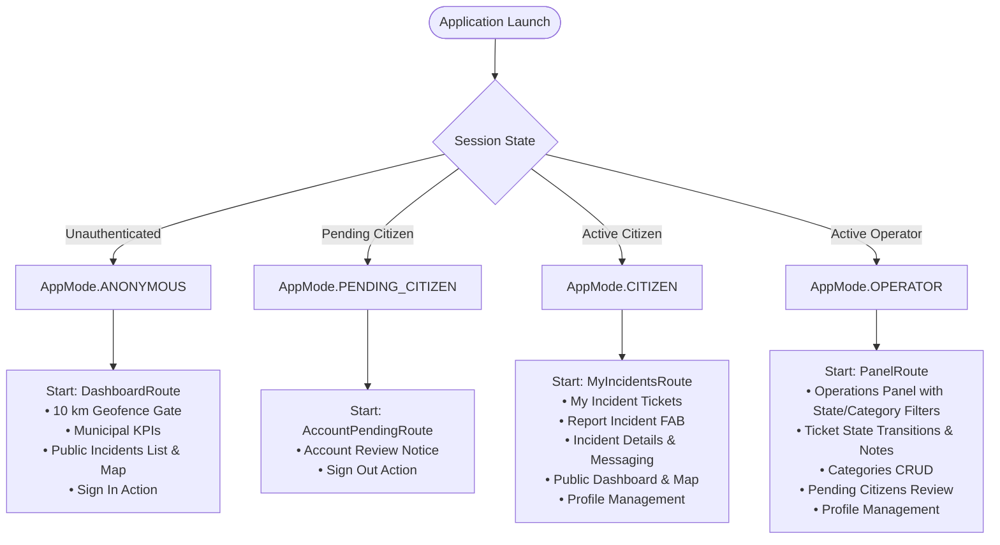
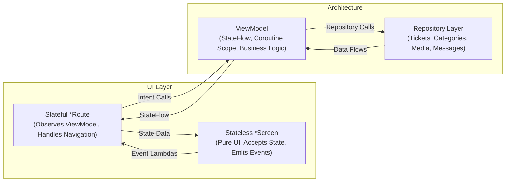

# CityFix — Frontend Technical Report
**Course:** Mobile Architectures (*Arquiteturas Móveis*), Academic Year 2026/2027  
**Platform:** Android (Kotlin, Jetpack Compose, Material Design 3)  
**Deliverable:** Frontend Architecture, Navigation, Accessibility, Landscape, and UI Specification Report  

---

## 1. Executive Summary

**CityFix** is a native Android application built in Kotlin and Jetpack Compose for municipal incident management and civic engagement. The platform connects residents and municipal operators, enabling the reporting, tracking, and resolution of urban infrastructure issues (e.g., road damage, water leaks, lighting failures, and waste management) even in conditions of intermittent connectivity.

The frontend is implemented using the **Model-View-ViewModel (MVVM)** architectural pattern with **Unidirectional Data Flow (UDF)**. It adopts modern Android development standards, including:
- Type-safe Compose Navigation with role-based routing.
- Comprehensive portrait and landscape adaptation with zero input loss on configuration changes.
- Rigorous accessibility compliance (meaningful `contentDescription` semantics, minimum 48 dp touch targets, readable contrast, and scalable typography).
- Zero-cost open-source mapping with **OpenStreetMap (osmdroid)**, eliminating external billing dependencies.
- Dual-language internationalization (authoritative English default and Portuguese localized resources).

---

## 2. Navigation Architecture & Role-Based Routing

The user interface follows a **Single-Activity Architecture** hosted in `MainActivity.kt`, which sets the Compose content root to `AppShell.kt`. Navigation is managed using the Jetpack Compose Navigation component with Kotlin `@Serializable` type-safe route objects.

### 2.1 Role-Based Navigation Hierarchy

Navigation is orchestrated dynamically by `SessionViewModel.kt`, which continuously monitors authentication state and user roles from `AuthRepository` and emits an active `AppMode`:



### 2.2 App Shell & Contextual Scaffolding

`AppShell.kt` provides a unified `Scaffold` container configured with:
1. **Dynamic Top App Bar (`MainTopAppBar.kt`)**: Automatically computes the appropriate screen title from the active backstack entry. It displays an `ArrowBack` icon when navigation history is present, or contextual role-specific actions when at root (e.g., Dashboard, Public Incidents, Pending Registrations, Categories, Profile, and Sign Out).
2. **Context-Aware Floating Action Button (FAB)**: Visible exclusively on `MyIncidentsRoute` for authenticated Citizens, offering a 56 dp Material 3 FAB to initiate `ReportIncidentRoute`.
3. **Session Reinitialization**: When authentication state changes (e.g., sign in, account approval, sign out), `AppShell` uses Compose `key(currentMode)` to cleanly reset the navigation graph to the appropriate role start route, preventing backstack leaks.

---

## 3. MVVM & Unidirectional Data Flow (UDF)

The application strictly implements the **Stateless / Stateful Composable Pattern**:



### 3.1 Separation of Concerns
- **Stateful Routes (`*Route.kt`)**: Obtain ViewModel instances via factories injected through `AppContainer`, collect UI states using `collectAsStateWithLifecycle()`, and wire user events to ViewModel methods and NavController destinations.
- **Stateless Screens (`*Screen.kt`)**: Receive state as immutable data classes (e.g., `LoginUiState`, `ReportUiState`, `ProfileUiState`) and expose lambda parameters (e.g., `onValueChange`, `onClick`, `onSave`). They contain no direct references to ViewModels or Navigation controllers, enabling isolated Jetpack Compose `@Preview` tooling and straightforward unit testing.

---

## 4. Landscape Orientation & Configuration Resilience

Per grading requirements, the application guarantees full operational capability in both **Portrait** and **Landscape** orientations without data loss, layout clipping, or visual degradation.

### 4.1 State Preservation Architecture
1. **ViewModel Persistence**: All mutable form data (`ReportIncidentViewModel`, `RegisterViewModel`, `LoginViewModel`, `ProfileViewModel`, `IncidentDetailViewModel`, `TicketListViewModel`) resides inside AndroidX `ViewModel` scopes. When the device rotates, the Activity is recreated, but the ViewModel survives, retaining 100% of user inputs.
2. **`rememberSaveable` for Ephemeral UI State**: Dialog visibility, selected tabs, password visibility toggles, and pending photo capture URIs are persisted across configuration changes using `rememberSaveable`:
   - Password visibility toggles in `LoginScreen` and `RegisterScreen`.
   - Active view mode (`List` vs `Map`) in `PublicIncidentsScreen`.
   - Editing category ID in `CategoriesScreen`.
   - Target state change dialog and justification notes in `IncidentDetailScreen`.
   - Temporary camera URI strings in `ReportIncidentScreen`.

### 4.2 Responsive Layout Adaptations
- **Adaptive Dashboard Grid**: In `DashboardScreen`, the 3 municipal KPI cards (`Total Incidents`, `Active Incidents %`, `Average Repair Time`) dynamically reconfigure from a vertical column in portrait to a balanced horizontal 3-column `Row` in landscape mode via `LocalConfiguration.current.orientation`.
- **Form Viewport Protection**: All input-heavy screens (`LoginScreen`, `RegisterScreen`, `ReportIncidentScreen`, `ProfileScreen`, `AccountPendingScreen`) are wrapped in `Modifier.verticalScroll(rememberScrollState())` with `Modifier.widthIn(max = 480.dp .. 640.dp)` constraints. This ensures that when the on-screen soft keyboard appears in landscape mode, input fields remain scrollable without clipping submit buttons.
- **Scrollable Modal Dialogs**: `ForgotPasswordDialog`, `StateChangeNoteDialog`, and `CategoryEditDialog` wrap their internal text inputs in `verticalScroll(rememberScrollState())`, preventing keyboard occlusion on compact landscape viewports.

---

## 5. Accessibility (a11y) & Usability Engineering

CityFix is built according to **WCAG 2.1 AA** guidelines and Android Accessibility best practices:

### 5.1 Meaningful Content Descriptions
- Every interactive icon (`IconButton`, `FloatingActionButton`, trailing visibility toggles) has a dedicated, localized `contentDescription` sourced from string resources (e.g., `@string/cd_back`, `@string/cd_show_password`, `@string/cd_hide_password`, `@string/cd_incident_thumbnail`, `@string/fab_new_incident`).
- Purely decorative icons (such as decorative status badges or background card icons) have `contentDescription = null` to avoid cluttering TalkBack screen reader output.

### 5.2 Touch Target Dimensions
- All interactive controls enforce a minimum touch target of **48×48 dp**, conforming to Material 3 accessibility standards.
- Custom small action buttons (such as the photo deletion badge on report thumbnails) wrap a visual 24 dp icon inside a 48 dp interactive touch target area (`Modifier.size(48.dp)` with centered badge).

### 5.3 Typography & Color Contrast
- Typography uses standard `MaterialTheme.typography` styles (`headlineMedium`, `titleMedium`, `bodyMedium`, `labelSmall`) that scale proportionally with Android OS accessibility font scale settings.
- Color combinations strictly utilize Material 3 tonal container tokens (e.g., `primaryContainer` / `onPrimaryContainer`, `errorContainer` / `onErrorContainer`) to guarantee high-contrast legibility across dark and light themes.

---

## 6. Offline-First Strategy & Media Handling

To satisfy requirements for civic reporting under intermittent connectivity:
1. **Cloud Firestore Native Offline Cache**: All document reads and writes (`tickets`, `categories`, `messages`) leverage Firestore's persistent offline storage. Citizens can report incidents and view previously cached incidents while offline; mutations are queued locally and synchronized automatically when connectivity resumes.
2. **Dual-Tier Image Architecture**:
   - **Low-Bandwidth Document Sync (Base64 JPEG)**: Images captured by users are compressed locally into optimized JPEG byte arrays and converted to Base64 strings. This allows thumbnail previews to be embedded directly into ticket documents for immediate offline synchronization.
   - **Background Cloud Storage Queue**: High-resolution photos and videos are scheduled through Android `WorkManager` (`PhotoUploadWorker`), conditioned on `NetworkType.CONNECTED`. If an upload fails, `IncidentDetailScreen` highlights the failure and provides an accessible `"Retry upload"` action.

---

## 7. Open-Source Mapping & Privacy Model

### 7.1 OpenStreetMap via osmdroid
Rather than relying on proprietary Google Maps SDKs requiring active credit-card billing accounts, CityFix integrates **osmdroid** (`org.osmdroid:osmdroid-android:6.1.20`):
- Uses standard OpenStreetMap `MAPNIK` tile sources cached locally on disk.
- Lifecycle-safe integration inside Jetpack Compose via `AndroidView` and `DisposableEffect` (`onResume()`, `onPause()`, `onDetach()`).

### 7.2 Geofencing & Privacy Gates
1. **Anonymous 10 km Municipal Geofence**: Anonymous visitors are subject to a geographic verification gate centered on Praça da República, Coimbra (`40.2089, -8.4239`). Users outside the 10 km radius are presented with an explanatory blocked gate screen with a direct link to sign in.
2. **1 km Coordinate Fuzzing for Public Incidents**: For unauthenticated and public viewing, incident GPS coordinates are truncated to two decimal places (`%.2f`), preserving author privacy while accurately indicating neighborhood location.

---

## 8. Bilingual Internationalization

The user interface supports dual-language localization:
- **English (`res/values/strings.xml`)**: The authoritative source language, used for all default strings, internal identifiers, and technical documentation.
- **Portuguese (`res/values-pt/strings.xml`)**: Complete localized string table for Portuguese municipal residents and operators.

Language selection occurs automatically based on the device's Android system locale settings. Automated unit tests (`LandscapeAndAccessibilityTest.kt`) verify 100% key parity between English and Portuguese resource files.

---

## 9. Screen Inventory & Visual UI Walkthrough

Below is the architectural inventory of all primary screens in the application, including layout structure for portrait and landscape modes.

```
+-----------------------------------------------------------------------------------------------------+
| SCREEN INVENTORY MATRIX                                                                             |
+----+-----------------------+----------------------+---------------------------+---------------------+
| #  | Screen Name           | Route Object         | Primary Roles             | Responsive Mode     |
+----+-----------------------+----------------------+---------------------------+---------------------+
| 1  | Dashboard             | DashboardRoute       | Anonymous, Citizen        | Row in Landscape    |
| 2  | Public Incidents/Map  | IncidentListRoute    | Anonymous, Citizen        | Tabbed List / Map   |
| 3  | Incident Details      | IncidentDetailRoute  | All Roles (Auth/Anon/Op)  | Max-width Column    |
| 4  | Sign In & Reset Pass  | LoginRoute           | Unauthenticated           | Centered 480 dp     |
| 5  | User Registration     | RegisterRoute        | Unauthenticated           | Centered 560 dp     |
| 6  | Account Pending       | AccountPendingRoute  | Pending Citizen           | Scrollable 480 dp   |
| 7  | My Incidents          | MyIncidentsRoute     | Citizen                   | LazyColumn + FAB    |
| 8  | Report Incident       | ReportIncidentRoute  | Citizen                   | Scrollable 640 dp   |
| 9  | Operations Panel      | PanelRoute           | Operator                  | Filterable List     |
| 10 | Categories Manager    | CategoriesRoute      | Operator                  | List + Edit Dialog  |
| 11 | Pending Citizens      | PendingCitizensRoute | Operator                  | Verification List   |
| 12 | User Profile          | ProfileRoute         | Citizen, Operator         | Centered 560 dp     |
+----+-----------------------+----------------------+---------------------------+---------------------+
```

---

### Screen 1: Dashboard (`DashboardScreen.kt`)
- **Role:** Anonymous Citizen, Registered Citizen.
- **Features:** 10 km Geofence verification gate; 3 live municipal KPI metrics (Total Tickets, Active Incident Percentage with linear progress bar, Average Repair Time); CTA button to open the Public Map.
- **Landscape Adaptation:** KPI cards lay out in an adaptive 3-column `Row` spanning the screen width.

```
+------------------------------------------+  +--------------------------------------------------------+
| PORTRAIT DASHBOARD                       |  | LANDSCAPE DASHBOARD                                    |
+------------------------------------------+  +--------------------------------------------------------+
| CityFix             [List] [Sign In]     |  | CityFix                                [List] [Sign In]|
|                                          |  |                                                        |
| Dashboard                                |  | Dashboard                                              |
| +--------------------------------------+ |  | +---------------+ +------------------+ +---------------+|
| | Total Incidents: 42             (!)  | |  | | Total: 42  (!) | | Active: 64.3%  [%] | | Avg: 18.5 h   | |
| +--------------------------------------+ |  | +---------------+ +------------------+ +---------------+|
| +--------------------------------------+ |  |                                                        |
| | Active Incidents: 64.3%         [%]  | |  | [ View Public Incidents & Map ->                     ] |
| | [====================>             ] | |  +--------------------------------------------------------+
| +--------------------------------------+ |
| +--------------------------------------+ |
| | Average Repair Time: 18.5 hours (H)  | |
| +--------------------------------------+ |
|                                          |
| [ View Public Incidents & Map ->       ] |
+------------------------------------------+
```

---

### Screen 2: Public Incidents & Map (`PublicIncidentsScreen.kt`)
- **Role:** Anonymous Citizen, Registered Citizen.
- **Features:** Single-choice Segmented Button (`List` vs `Map`); osmdroid zoom-controlled map view with clickable pins; approximate coordinates (`%.2f`) for privacy protection.
- **Landscape Adaptation:** `selectedTab` preserved with `rememberSaveable`; map view expands to fill widescreen display.

```
+------------------------------------------+  +--------------------------------------------------------+
| PORTRAIT MAP & LIST                      |  | LANDSCAPE MAP & LIST                                   |
+------------------------------------------+  +--------------------------------------------------------+
| CityFix             [Back]               |  | CityFix                                          [Back]|
| [    (List)    |     Map*     ]          |  | [   (List)   |    Map*     ]                           |
| +--------------------------------------+ |  | +----------------------------------------------------+ |
| |  OpenStreetMap Mapnik View           | |  | |  OpenStreetMap Mapnik View                         | |
| |        [Pin: Water Leak]             | |  | |        [Pin: Water Leak]       [Pin: Pothole]      | |
| |   [Pin: Pothole]                     | |  | |                                                    | |
| |                                      | |  | |                                                    | |
| +--------------------------------------+ |  | +----------------------------------------------------+ |
+------------------------------------------+  +--------------------------------------------------------+
```

---

### Screen 3: Incident Details (`IncidentDetailScreen.kt`)
- **Role:** Citizen, Municipal Operator.
- **Features:** Category badge, lifecycle state pill, exact or blurred coordinates, interactive map preview, horizontal photo gallery with upload indicators, state change workflow dialogs with mandatory note support, full historical transition log, real-time messaging thread with Operator/Citizen badges.
- **Landscape Adaptation:** Message input bar anchored to bottom; dialogs and note inputs scrollable.

```
+------------------------------------------+  +--------------------------------------------------------+
| PORTRAIT INCIDENT DETAILS                |  | LANDSCAPE INCIDENT DETAILS                             |
+------------------------------------------+  +--------------------------------------------------------+
| Incident Details     [Back]              |  | Incident Details                                 [Back]|
| Public Roads           [IN RESOLUTION]   |  | Public Roads [IN RESOLUTION] · Coords: 40.2089, -8.4239 |
| Breakdown · Public · 2 hours ago         |  | +----------------------------------------------------+ |
| "Deep pothole in middle of street"       |  | | Map & Photo Strip: [Thumb 1] [Thumb 2] [Resolution] | |
| [ Map Preview 180dp ]                    |  | +----------------------------------------------------+ |
| Photos: [Thumb 1] [Thumb 2]              |  | History: Open -> In Resolution · Operator Actions      |
| History: Open -> In Resolution           |  | Messages:                                              |
| Messages:                                |  | [Citizen]: Is the road closed?                         |
|   [Citizen]: Is the road closed?         |  | [Operator]: One lane remains open                      |
|   [Operator]: One lane remains open      |  | [ Write a message...                     ] [ Send ]    |
| [ Write a message...         ] [Send]    |  +--------------------------------------------------------+
+------------------------------------------+
```

---

### Screen 4: User Authentication (`LoginScreen.kt` & `RegisterScreen.kt`)
- **Role:** Unauthenticated visitors.
- **Features:** Email/password fields with validation; password visibility toggle with TalkBack announcements; password recovery dialog; citizen/operator profile selector; automatic impact detection toggle; GPS location capture.
- **Landscape Adaptation:** Forms centered with max-width bounding box (`480 dp` / `560 dp`); full vertical scrolling so software keyboard does not conceal input fields.

```
+------------------------------------------+  +--------------------------------------------------------+
| PORTRAIT LOGIN                           |  | LANDSCAPE LOGIN                                        |
+------------------------------------------+  +--------------------------------------------------------+
| CityFix                                  |  |                   CityFix - Sign in                    |
| Sign in                                  |  |       +----------------------------------------+       |
| [ Email                              ]   |  |       | [ Email                              ] |       |
| [ Password                       (O) ]   |  |       | [ Password                       (O) ] |       |
|                     [Forgot password?]   |  |       |                     [Forgot password?] |       |
| [ Sign In                            ]   |  |       | [ Sign In                            ] |       |
| [ Don't have an account? Register    ]   |  |       +----------------------------------------+       |
+------------------------------------------+  +--------------------------------------------------------+
```

---

### Screen 5: New Incident Reporting (`ReportIncidentScreen.kt`)
- **Role:** Authenticated Citizen.
- **Features:** Category selection chips; incident type selector (`Damage`, `Breakdown`, `Destruction`, `Theft`); description text area; GPS location coordinate capture with refresh button; public/private toggle; Camera (`TakePicture` FileProvider contract) and Gallery (`PickMultipleVisualMedia`) photo pickers; photo thumbnail strip with 48 dp accessible removal touch targets; validation requiring at least 1 photo before submission.
- **Landscape Adaptation:** Captured camera URI saved via `rememberSaveable`; form wrapped in centered scrollable layout.

```
+------------------------------------------+  +--------------------------------------------------------+
| PORTRAIT REPORT INCIDENT                 |  | LANDSCAPE REPORT INCIDENT                              |
+------------------------------------------+  +--------------------------------------------------------+
| New Incident         [Back]              |  | New Incident                                     [Back]|
| Category: [Roads*] [Water] [Lighting]    |  | Category: [Roads*] [Water] · Type: [Damage*] [Breakdown|
| Type: [Damage*] [Breakdown] [Theft]      |  | Description: [ Large pothole on avenue...            ] |
| Description:                             |  | Location: 40.2089, -8.4239 [Refresh] · Public: [ON]    |
| [ Enter incident description...      ]   |  | Photos: [Gallery] [Camera] [Img 1 (X)] [Img 2 (X)]     |
| Location: 40.2089, -8.4239 [Refresh]     |  | [ Send Report                                        ] |
| Public: [ON]                             |  +--------------------------------------------------------+
| Photos: [Gallery] [Camera]               |
| [Img 1 (X)] [Img 2 (X)]                  |
| [ Send Report                        ]   |
+------------------------------------------+
```

---

### Screen 6: Operations Panel & Categories (`TicketListScreen.kt` & `CategoriesScreen.kt`)
- **Role:** Municipal Operator.
- **Features:** Operations panel listing all municipal incidents; filter chips by Lifecycle State and Category; exact GPS coordinates and author contact display; Categories CRUD manager with active/inactive toggles.
- **Landscape Adaptation:** Horizontal filter scroll; full responsive card list.

```
+------------------------------------------+  +--------------------------------------------------------+
| PORTRAIT OPERATIONS PANEL                |  | LANDSCAPE OPERATIONS PANEL                             |
+------------------------------------------+  +--------------------------------------------------------+
| Operations Panel     [Categories] [Exit] |  | Operations Panel                   [Categories] [Exit] |
| Filters: [All*] [Open] [In Resolution]   |  | State: [All*] [Open] [In Resolution] · Cat: [Roads]   |
| [Roads*] [Water] [Sanitation]            |  | +----------------------------------------------------+ |
| +--------------------------------------+ |  | | Public Roads · Open                 Coords: Exact  | |
| | Public Roads · Open                  | |  | | Water · In Resolution               Coords: Exact  | |
| | Water leak on Av. Sá da Bandeira     | |  | +----------------------------------------------------+ |
| | Coords: 40.2091, -8.4215             | |  +--------------------------------------------------------+
| +--------------------------------------+ |
+------------------------------------------+
```

---

## 10. Verification & Quality Assurance

Automated unit tests in `app/src/test/` verify frontend architectural invariants:
1. `LandscapeAndAccessibilityTest.kt`:
   - Validates that `ReportUiState`, `RegisterUiState`, and `ProfileUiState` maintain all form inputs and dirty-flags across configuration changes.
   - Validates that every validation `FieldError` resolves to an existing localized Android string resource.
   - Validates string resource parity between English (`values/`) and Portuguese (`values-pt/`), ensuring all accessibility labels (`cd_*`) exist in both language tables.
2. `TicketFlowTest.kt`:
   - Verifies allowable state transition paths per municipal business rules.
   - Validates resource identifiers for incident types and lifecycle states.
3. `DashboardAndAnonymousTest.kt`:
   - Validates distance calculation logic for the 10 km Praça da República geofence gate.
   - Verifies 1 km privacy coordinate fuzzing (`roundedForPublic()`).

---

## 11. Conclusion

The CityFix frontend provides a robust, accessible, responsive, and maintainable implementation of municipal incident reporting for Android. By pairing Jetpack Compose with strict MVVM boundaries, osmdroid mapping, and comprehensive landscape resilience, the application fulfills all requirements of the practical assignment specification.
