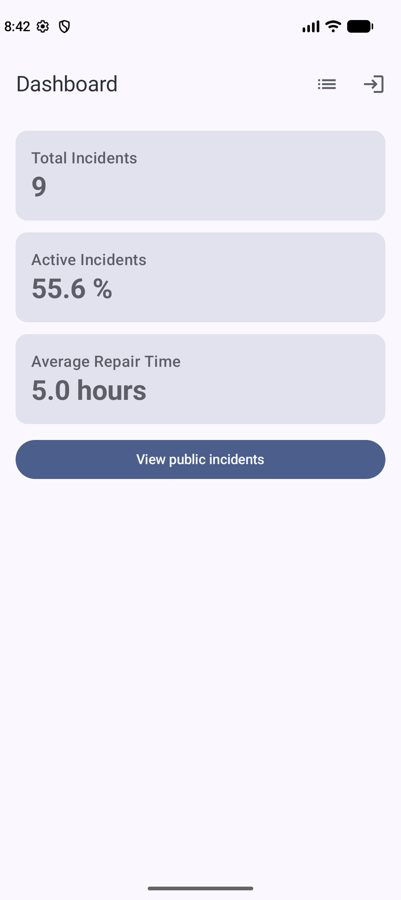
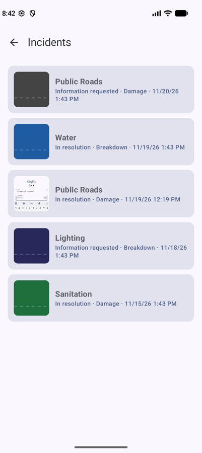
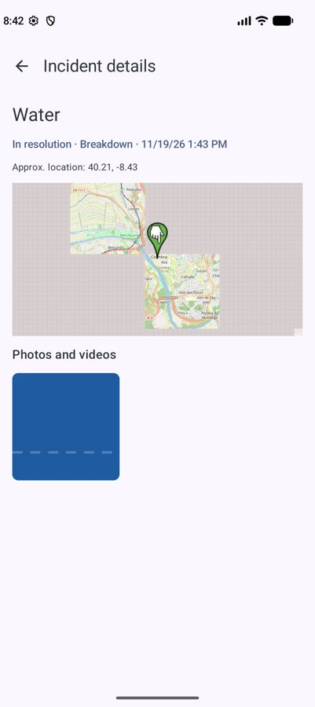
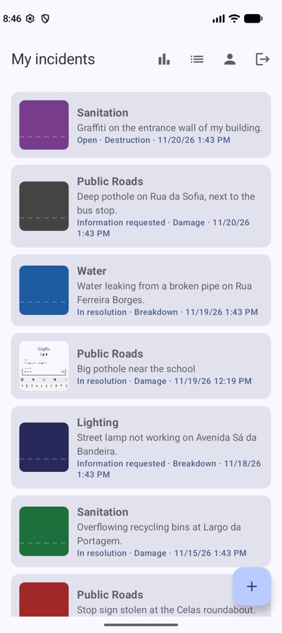
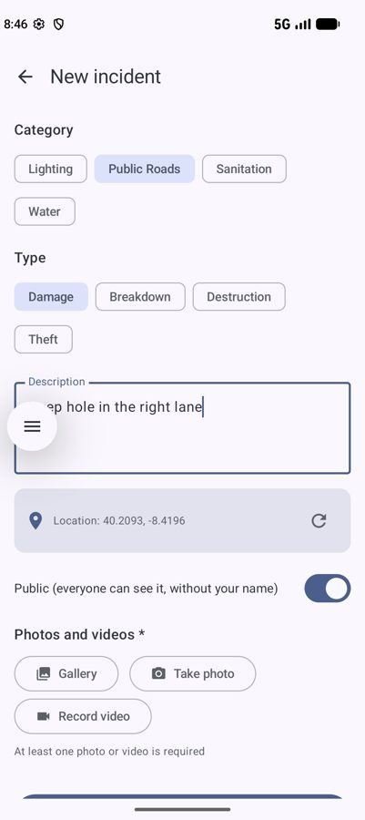
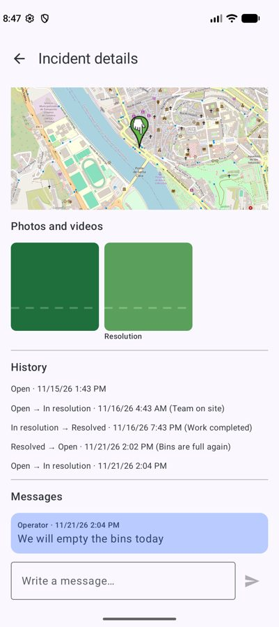
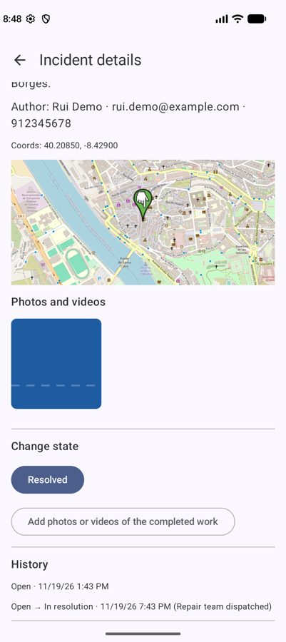
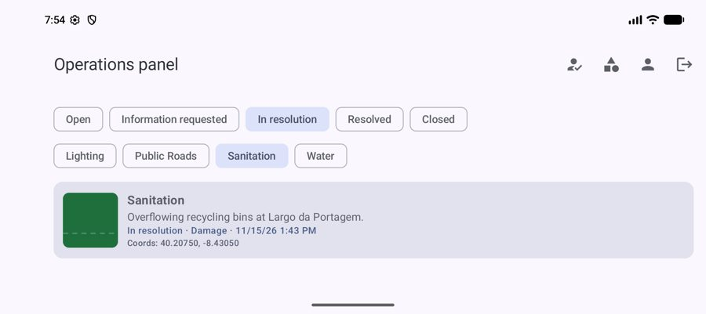

# CityFix — Technical Report

**Mobile Architectures** · Bachelor in Informatics Engineering · Coimbra Institute of Engineering (ISEC) · 2026/27

**Authors:** Musa Baba Akanya (a2026109854) · Artem Snigur (a2026122037)

**Repository:** Android project `CityFix` (Kotlin, Jetpack Compose) with Firebase Authentication, Cloud Firestore,
Firebase Cloud Messaging and a small Google Apps Script relay (`server/relay`).

---

## 1. Introduction

CityFix is an Android application for reporting and following problems in the public space of a municipality
(damaged roads, water leaks, waste, lighting, signage). Citizens report incidents with photos or videos and a
location; municipal operators validate citizens, manage categories and move each ticket through its lifecycle
until it is closed. Anonymous visitors near Coimbra see public statistics and public incidents.

This report explains the technical decisions, how each functional requirement was implemented, where we deviated
from the assignment and why, and what we would improve next.

### 1.1 Main constraint: the free Firebase plan

The project runs on the free **Spark** plan. Cloud Functions, Cloud Storage and Firebase phone/TOTP MFA need the
paid **Blaze** plan, which we decided not to use. Every place where the assignment assumes one of those services was
solved with a free alternative, mainly a small **Google Apps Script web app** (the *relay*, section 9). These
choices are marked with **Deviation** in the tables below.

---

## 2. Requirements coverage

### 2.1 Profiles (assignment section I)

| Requirement | Implementation | Status |
|---|---|---|
| Anonymous: only within 10 km of Praça da República | `AnonymousGate` checks the current location (`FusedLocationProvider`) against `AppConfig.ANONYMOUS_AREA_CENTER`; outside, the screens are blocked with a sign-in option | Done |
| Anonymous: dashboard (avg repair time, total, % active) | `FirebasePublicRepository.observeDashboard()` computes the numbers from the public ticket copies | Done (public tickets only) |
| Anonymous: public list and details, no author, approximate location, zoomed-out map | `publicTickets` collection holds a copy without author and with coordinates rounded to 2 decimals (~1 km); osmdroid map at low zoom; photos and videos of public tickets are readable without sign-in | Done |
| Citizen registration (name, email, phone, NIF, location, optional photo, impact detection choice), unique NIF, validation, pending until activated | `RegisterScreen` + `Validation` (email, Portuguese phone, NIF check digit); `FirebaseAuthRepository.register` refuses a NIF already used by the same role; profile saved as `PENDING` | Done |
| Operator registration: municipal email domain, unique NIF, active immediately | Same flow, email must end with `@cm-coimbra.pt`, status `ACTIVE` | Done |
| Email/password with MFA, recovery by email | Password + email confirmation link + a 6-digit sign-in code emailed by the relay on every sign-in; password reset email | Done — **Deviation**: second factor is an emailed code, not Firebase MFA (section 5) |
| Profile management (name, NIF, location read-only) | `ProfileScreen`: phone, photo and impact detection editable | Done |
| Operator: validate pending citizens (name, NIF, location) | `PendingCitizensScreen` | Done |
| Operator: categories (create, edit, activate, deactivate); citizens only see active ones | `CategoriesScreen`; the report form loads `observeCategories(activeOnly = true)` | Done |
| Operator panel: all tickets, exact coordinates, author contact, full media history; filters | `TicketListScreen(allTickets = true)` with state and category filters; details show author contact, all report and resolution media | Done |
| Ticket creation: category, type, description, ≥1 photo/video, public/private | `ReportIncidentScreen` (gallery, camera photo, camera video) | Done |
| Citizen: list of own tickets, details with messaging, reopen within 5 days | `TicketListScreen`, `IncidentDetailScreen`, chat in `tickets/{id}/messages`, reopen dialog with mandatory justification | Done |
| Impact detection | `ImpactDetector` (accelerometer) in a foreground service; suggests a road-defect report | Done |
| Duplicate aggregation (same category and type within ~10 m) | `findDuplicate` in `FirebaseTicketRepository`: the citizen becomes a follower of the existing ticket and their photos are added to it | Done |
| Proximity alert (operator within 20 m) | `OperatorGeofence` on the operator's phone marks the ticket and pushes a notification to its citizens | Done |

### 2.2 Lifecycle, notifications, persistence (sections II–IV)

| Requirement | Implementation | Status |
|---|---|---|
| States Open → Information request → In resolution → Resolved → Closed, with timestamps | `LifecycleState.allowedNext()`; every change writes a `StateChange` in `tickets/{id}/history` | Done |
| Information request in both directions | Operator moves the ticket to *Information requested*; citizen uses *Ask the municipality*; the other side gets a push | Done |
| Resolved requires photo/video evidence | `changeState` refuses `RESOLVED` without `RESOLUTION` media | Done |
| Closed after 5 days without contest, locked | `TicketWatcher` closes expired tickets; closed tickets show a lock and accept no changes | Done — **Deviation**: done by the app (no server timer), see section 7 |
| Notifications: state changes, messages, proximity, 24 h reminder | Remote push via FCM (relay) for the first three; local notification for the reminder | Done — **Deviation**: FCM messages are sent by the relay instead of Cloud Functions |
| Firebase Authentication with cached session | Firebase Auth keeps the session on the device | Done |
| Firestore with offline cache | Firestore persistence; writes are not awaited so they queue offline | Done |
| Local compression; large media uploaded by WorkManager when connected | `PhotoUploadWorker` with `NetworkType.CONNECTED` | Done — **Deviation**: photos stored in Firestore as Base64, videos in Google Drive (no Cloud Storage on Spark) |

### 2.3 Development guidelines (section V)

| Guideline | Status |
|---|---|
| Jetpack Compose, MVVM, stateless and stateful components | Done (section 3) |
| Runtime permissions: location, camera, notifications | Done. Background location is not requested: monitoring runs in a foreground service of type `location`, which Android allows with the foreground permission only |
| Local image optimisation, compression and thumbnails | Done (1280 px photo, 200 px thumbnail, JPEG) |
| English by default, Portuguese from system settings | Done (`values/`, `values-pt/`) |
| Portrait and landscape without loss | Done, checked on every screen (section 11) |
| Context-aware navigation (top bars, actions, FAB) | Done |
| Accessibility | Content descriptions, Material components with 48 dp targets, theme typography |

---

## 3. Architecture

### 3.1 Layers

```
ui/            Compose screens (stateless *Screen) + stateful entry points (*Route / ViewModel)
  navigation/  AppShell (Scaffold, top bar, FAB, NavHost), SessionViewModel, type-safe routes
data/
  model/       Kotlin data classes stored in Firestore (User, Ticket, PublicTicket, Message, ...)
  repository/  Interfaces: AuthRepository, TicketRepository, MediaRepository, MessageRepository, ...
  firebase/    Firebase implementations of those interfaces
  fake/        In-memory implementations used for UI work without Firebase
  relay/       Client of the Apps Script relay
  media/       Image and video compression
di/            AppContainer: creates the repositories once (manual dependency injection)
worker/        WorkManager workers (media upload, periodic ticket check)
notifications/ TicketWatcher (auto-close, 24 h reminder) and notification helper
push/          FCM: token registration, sending, receiving
monitoring/    Foreground service: impact detection and operator geofence
server/relay/  Google Apps Script relay (push, sign-in codes, videos)
```

The UI never talks to Firebase directly. ViewModels receive repository interfaces from `AppContainer`, which
chooses the Firebase or the fake implementation (`CityFixApp.USE_FIREBASE`). The fake implementation let the
frontend be built before the backend existed and keeps screens testable without a network.

### 3.2 MVVM and state

- **ViewModels** expose `StateFlow` UI state (e.g. `LoginUiState`, `ReportUiState`) and handle events.
- **Stateful** composables (`LoginRoute`, `RegisterRoute`, ...) collect the state with
  `collectAsStateWithLifecycle()` and pass it, with event lambdas, to **stateless** `*Screen` composables, which
  are previewable and contain no ViewModel or navigation code.
- Firestore snapshots become `Flow`s (`snapshots().map { ... }`), so screens update in real time when another user
  changes a ticket.

### 3.3 Navigation and roles

`SessionViewModel` turns the session (`Loading`, `Anonymous`, `SignedIn(user)`) into an `AppMode`:
anonymous, pending citizen, citizen or operator. `AppShell` builds the navigation graph for that mode, so a citizen
can never reach operator routes and signing out resets the back stack. Routes are `@Serializable` objects
(type-safe Compose Navigation). The top bar shows the screen title, a back arrow inside a flow and role-specific
actions at the root; the citizen's list has a FAB for a new incident.

---

## 4. Data model (Cloud Firestore)

| Collection | Content | Who reads |
|---|---|---|
| `users/{uid}` | role, status, name, email, phone, NIF, location, photo (Base64), impact detection flag, FCM token | the user and operators |
| `categories/{id}` | name, active | everyone |
| `tickets/{id}` | author, followers, category, type, state, scope, description, exact location, media list (id, thumbnail, phase, upload state, type, who added it), timestamps | its citizens and operators |
| `tickets/{id}/history/{id}` | from, to, by, at, note | its citizens and operators |
| `tickets/{id}/messages/{id}` | sender, role, text, time | its citizens and operators |
| `tickets/{id}/media/{id}` | full photo (Base64) or video link + first frame | as the ticket; public tickets also anonymously |
| `publicTickets/{id}` | copy without author, rounded location, thumbnail, state | everyone |

**Why a separate `publicTickets` collection:** Firestore rules cannot hide single fields of a document. Keeping a
reduced copy is the simplest way to give anonymous users the public data without ever sending them the author or
the exact location. The copy is written in the same batch as the ticket, so they never disagree.

**Security rules** (`firestore.rules`): categories, public tickets and media of public tickets are readable by
anyone; everything else requires a signed-in user. Role checks (e.g. only operators change states) are enforced
by the app. Stricter, role-aware rules are listed as future work (section 13).

---

## 5. Authentication and profiles

1. **Registration** creates the Firebase Auth account, checks that no user of the same role has the NIF (Firestore
   query; on conflict the new account is deleted), saves the profile and sends the **email confirmation** link.
   Citizens start as `PENDING`; operators (municipal domain only) as `ACTIVE`.
2. **Sign-in, factor 1:** email and password. An account whose email is not confirmed is refused and gets a new
   link.
3. **Sign-in, factor 2:** the relay generates a 6-digit code, keeps it for 10 minutes and emails it to the
   account's address. The app shows a code dialog and treats the user as signed out until the relay confirms the
   code. Codes are single-use: a wrong code also invalidates it.
4. **Recovery:** Firebase password-reset email.

*Deviation:* Firebase's own MFA (SMS or TOTP) requires the Blaze plan / Identity Platform. The emailed code gives a
real second factor (possession of the mailbox) on the free plan. Its limitation is that Firestore rules do not
know about it — the app enforces it — so a modified client could skip it. Demo accounts with made-up addresses
(`AppConfig.EMAIL_CONFIRMATION_EXEMPT`) skip both email steps so the project can be demonstrated.

---

## 6. Tickets

- **Creation** works offline: media are copied into app storage, the ticket, its history entry and its public
  copy are written in one Firestore batch (not awaited), and the media upload is queued (section 8).
- **Duplicate aggregation:** before creating, the app queries active tickets with the same category and type and
  checks the distance (Haversine) locally, because Firestore has no geo queries. Within 10 m, the citizen is added
  to `followerIds` of the existing ticket and their media are attached to it. Followers see the ticket in their
  list, receive its notifications and can reopen it.
- **State changes** go through one helper (`moveTo`) that updates the ticket, adds the history entry, updates the
  public copy and sends the push, so every transition behaves the same way.
- **Messages** live in a sub-collection; the operator's messages are highlighted.

---

## 7. Notifications and time-based work

| Event | Mechanism |
|---|---|
| State change, information request, reopen | Push (FCM) to the other side: operator action → the ticket's citizens; citizen action → all operators (FCM topic `operators`) |
| New message | Push to the other side |
| Operator within 20 m | Push to the ticket's citizens |
| 24 h before automatic close | Local notification (`TicketWatcher`) |
| Automatic close after 5 days | `TicketWatcher` |

**Push without Cloud Functions.** After sign-in, each phone saves its FCM token in `users/{uid}.fcmToken`
(operators also subscribe to the `operators` topic; sign-out deletes the token). When something happens, the
acting phone posts `{recipients, data}` with its Firebase ID token to the relay, which verifies the token and calls
the **FCM HTTP v1 API**. Messages are *data* messages; the receiving phone builds the text in its own language
(`CityFixMessagingService`), so English and Portuguese users each read their language.

**Time-based work without a server.** No server can run a timer for us on the free plan, so `TicketWatcher` runs
while the app is open and every 15 minutes in the background (`TicketCheckWorker`, WorkManager). It closes tickets
whose 5-day window has passed (any signed-in citizen or operator who sees the ticket can do it) and shows the 24 h
reminder once per ticket. A ticket is therefore closed the next time one of its users' phones runs the check, not
at the exact minute.

---

## 8. Media

1. The picked or captured file is copied into app storage immediately (picker URIs expire), and the ticket lists
   it as `PENDING`.
2. `PhotoUploadWorker` (WorkManager, `NetworkType.CONNECTED`, retried on failure) processes the media added on
   this phone. **Photos** are scaled to 1280 px plus a 200 px thumbnail (JPEG, Base64). **Videos** are shortened to
   60 s, 480 px, ~1 Mbit/s with Media3 Transformer, and their first frame becomes the poster and thumbnail.
3. The full photo is written to `tickets/{id}/media/{mediaId}`; a video is sent to the relay, which stores it in
   Google Drive and returns a link saved in the same document.
4. The thumbnail is copied into the ticket's media list (and the public copy), and the state becomes `DONE`.

*Deviation:* Cloud Storage needs Blaze. Photos fit comfortably in a Firestore document after compression (1 MiB
limit); videos do not, so they go to Google Drive through the relay. Drive files are shared by link only.

---

## 9. The relay (Google Apps Script)

`server/relay/Code.gs` is a web app deployed under the project owner's Google account ("Execute as: Me"), so it
can use the owner's OAuth token for Google APIs without a service-account key. Every request carries the caller's
Firebase ID token, which the relay verifies with the Identity Toolkit `accounts:lookup` API before doing anything.

| Action | What it does |
|---|---|
| `push` | Reads recipients' FCM tokens from Firestore (REST) and sends FCM v1 messages; topics for operators |
| `sendCode` / `checkCode` | Sign-in codes kept in the script cache for 10 minutes, sent with `MailApp` |
| `uploadVideo` | Saves the MP4 in a Drive folder and returns its id |

Limits are generous for a prototype (e.g. 100 emails/day, 20 000 external calls/day on a free account). In a
production system the same three functions would be Cloud Functions and Cloud Storage.

---

## 10. Location features

- **Anonymous gate:** distance from Praça da República ≤ 10 km.
- **Monitoring service** (`MonitoringService`, foreground service of type `location`, with a persistent
  notification) runs when the user enabled impact detection or is an operator:
- **Impact detection:** accelerometer magnitude more than ~1.5 g away from gravity, at most once every 30 s.
  With the app open a dialog appears; otherwise a notification opens the report form preselected for public
  roads.
- **Operator geofence:** every 30 s the operator's location is compared with tickets *In resolution*; within
  20 m the ticket is marked and its citizens get a push (not repeated for an hour).
- **Permissions** are requested at runtime: location, camera, notifications (Android 13+). Because monitoring
  uses a foreground service, background location is not needed.

---

## 11. User interface

- **Material 3** components and theme typography (scales with the system font size).
- **Landscape:** every screen scrolls to its last control; form state lives in ViewModels and dialog/draft state
  in `rememberSaveable`. Checked on the emulator for login, registration, dashboard, public list and details, my
  incidents, report form, incident details with dialogs, profile, operator panel with filters, categories and
  pending citizens: typed text, chip selections, message drafts and open dialogs survive rotation.
- **Accessibility:** content descriptions on images and icon buttons (localized), Material touch targets.
- **Localization:** all strings in `values/strings.xml` (English, default) and `values-pt/strings.xml`.
- **Maps:** osmdroid (OpenStreetMap), because Google Maps needs a billing account.

---

### 11.1 Screenshots

<div class="shots">
<figure><figcaption>Anonymous dashboard</figcaption></figure>
<figure><figcaption>Public incidents</figcaption></figure>
<figure><figcaption>Public details (approximate location)</figcaption></figure>
<figure><figcaption>Citizen: my incidents</figcaption></figure>
<figure><figcaption>Citizen: new incident</figcaption></figure>
<figure><figcaption>Details: media, history, messages</figcaption></figure>
<figure><figcaption>Operator: author, exact location, state change</figcaption></figure>
</div>

<figure class="wide"><figcaption>Operator panel in landscape, filtered by state and category</figcaption></figure>

---

## 12. Testing

- **Unit tests** (`app/src/test`): validation rules (email, phone, NIF) and model rules (5-day reopen window,
  allowed state moves, active states, 10 km anonymous area, rounding of public locations).
- **Instrumented smoke tests** against the real Firebase project (`app/src/androidTest`), one per backend milestone:
- Smoke test B1: registration, NIF uniqueness, unconfirmed sign-in refused, activation, categories;
- Smoke test B2: ticket creation, photo upload by the worker, grouping of duplicates with the follower's photos, resolution;
- Smoke test B3: public data and messages.
- **Manual tests on the emulator** with live Firebase for every feature: offline creation and later sync, push with
  the app in the background, sign-in code with a real mailbox, video upload to Drive and playback, geofence (GPS
  set with `adb emu geo fix`), impact detection (`adb emu sensor`), rotation of every screen.
- **Demo data:** `DemoDataSeed` creates an operator, an active and a pending citizen, categories and tickets in
  every state.

---

## 13. Limitations and future improvements

1. **Server-side enforcement.** Role checks, the second factor and the automatic close run in the app. With Cloud
   Functions (Blaze) we would move them to the server: custom claims for roles and MFA, role-aware Firestore
   rules, and a scheduled function for closing tickets and reminders at the exact time.
2. **Storage.** Move media to Cloud Storage with resumable uploads; allow longer videos and private (non-link)
   access.
3. **Firebase MFA** with TOTP authenticator apps instead of emailed codes.
4. **NIF uniqueness** is checked with a query, which two simultaneous registrations could race; a transaction on a
   `nifs/{nif}` document would make it atomic.
5. **Geo queries** with geohashes for duplicates and the geofence when the number of tickets grows.
6. **Push delivery** depends on the sender being online; a server-side trigger would also notify when the change
   was made offline and synced later.
7. **Accessibility audit** with TalkBack and the Accessibility Scanner, and UI tests with Compose testing.

---

## 14. Demo accounts

| Role | Email | Note |
|---|---|---|
| Operator | `operator@cm-coimbra.pt` | demo address, skips the email steps |
| Citizen (active) | `rui.demo@example.com` | has tickets in every state |
| Citizen (pending) | `joana.demo@example.com` | waiting for activation |

The password of the demo accounts is given to the teachers at the defense.
